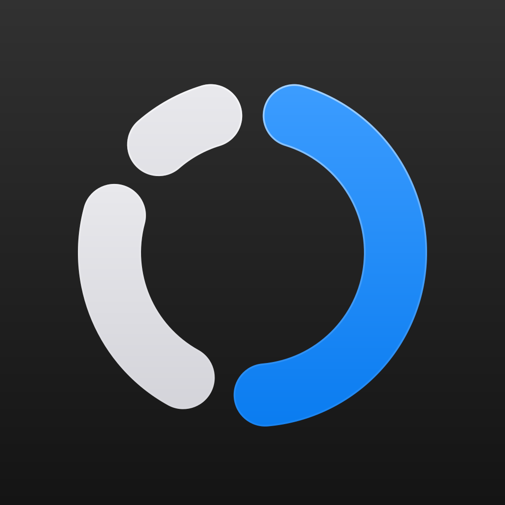
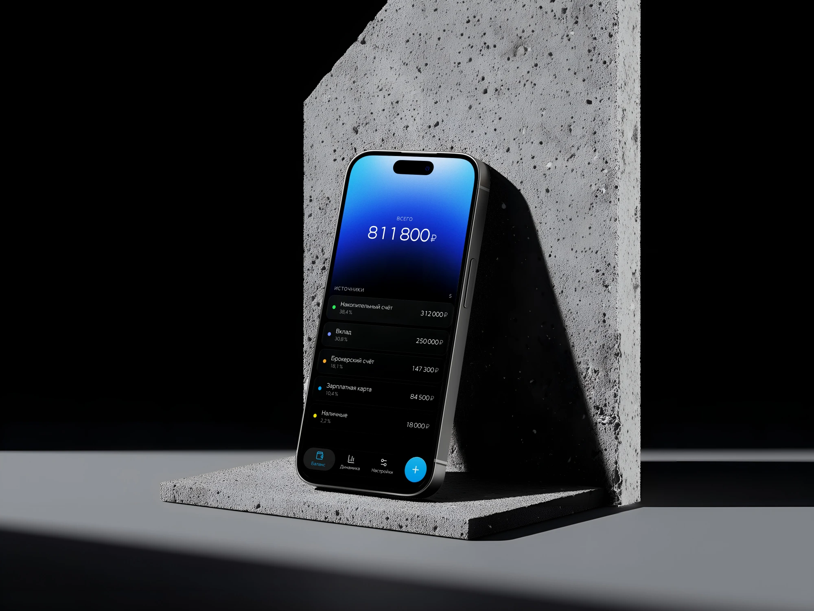
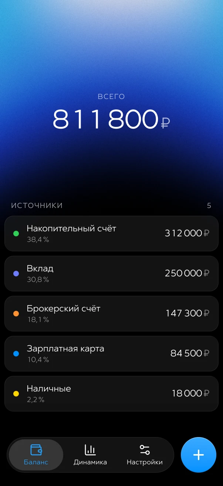
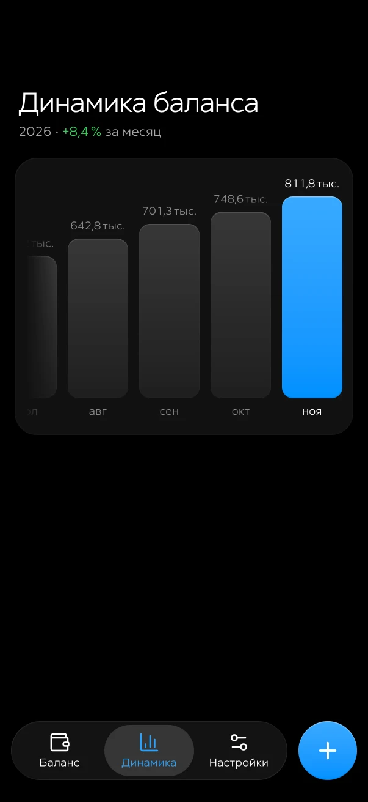
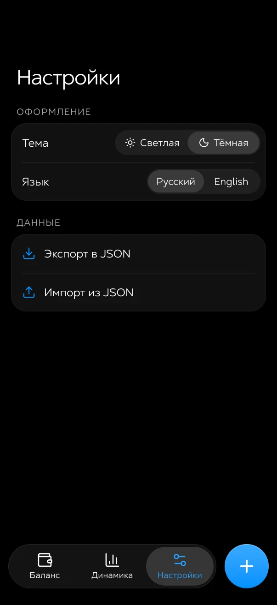

<div align="center">



# FinTrack

**Все ваши деньги — на одном экране.**

Карты, вклады, накопительные счета и наличные складываются в общий баланс,
а FinTrack показывает, как он растёт месяц за месяцем.

<br />



</div>

<br />

## Зачем оно нужно?

Деньги обычно разбросаны по нескольким банкам и кошелькам, и понять, сколько их всего, можно только в уме.
FinTrack собирает всё в одном месте: вы вносите суммы по каждому источнику и сразу видите итог,
долю каждого счёта и то, как меняется баланс со временем.

Без регистрации, без банковских подключений и без серверов — всё хранится только на вашем телефоне.

## Возможности

- **Общий баланс** — сумма по всем источникам крупно наверху, а под ней каждый счёт со своим цветом и долей в процентах.
- **Динамика по месяцам** — баланс на конец месяца запоминается сам, на графике видно, как он менялся, и сколько прибавилось за последний месяц.
- **Быстрое редактирование** — смахните карточку влево, чтобы изменить или удалить источник.
- **В стиле iOS 26** — стеклянная панель вкладок с живой линзой, мягкие анимации, тёмная и светлая темы.
- **Русский и английский** — суммы, проценты и даты оформляются по правилам выбранного языка.
- **Данные под вашим контролем** — всё лежит на устройстве, а резервную копию можно выгрузить в файл и перенести на другой телефон.

## Экраны

<div align="center">

|                                 Баланс                                  |                                  Динамика                                   |                                  Настройки                                   |
|:-----------------------------------------------------------------------:|:---------------------------------------------------------------------------:|:----------------------------------------------------------------------------:|
|  |  |  |

</div>

## Установка на телефон

FinTrack открывается в браузере, но задуман как приложение: добавьте его на домашний экран,
и он будет запускаться на весь экран, без адресной строки.

**iPhone** — откройте сайт в Safari → «Поделиться» → **«На экран Домой»**.

**Android** — откройте сайт в Chrome → меню ⋮ → **«Добавить на главный экран»**.

## Резервная копия

В **Настройках → Данные** можно выгрузить все источники и историю баланса в файл и загрузить их обратно —
например, при переезде на новый телефон. Повреждённый или чужой файл приложение не примет.

## Для разработчиков

FinTrack написан на React и TypeScript и собирается Vite в обычный статический сайт —
его можно разместить на любом хостинге.

```bash
npm install
npm run dev     # http://localhost:5173
npm run build   # готовая сборка в dist/
```

## Благодарности

- Панель вкладок сделана на основе [Glisse](https://github.com/0kzh/glisse) Кельвина Чжана — реализации Liquid Glass для веба (MIT).
- Шрифт — Steppe.
